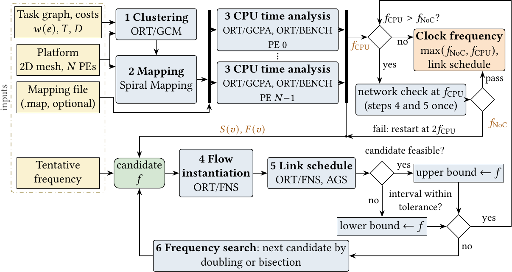
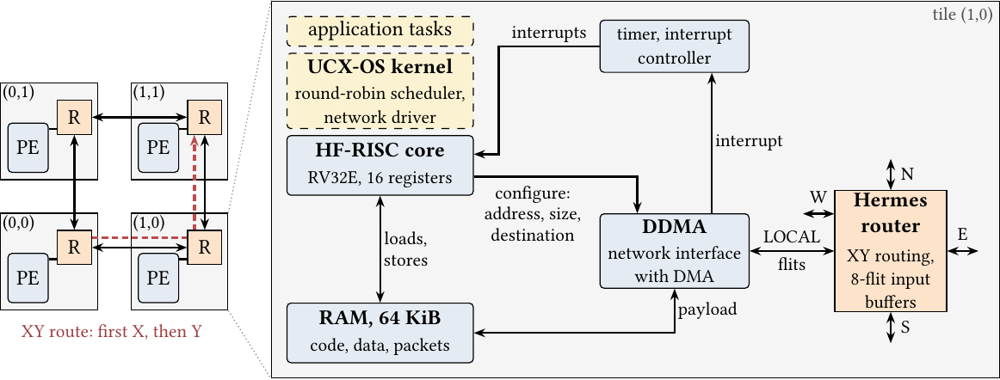
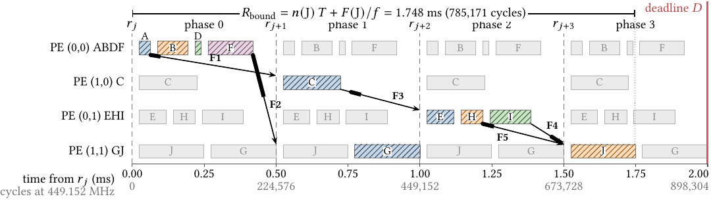
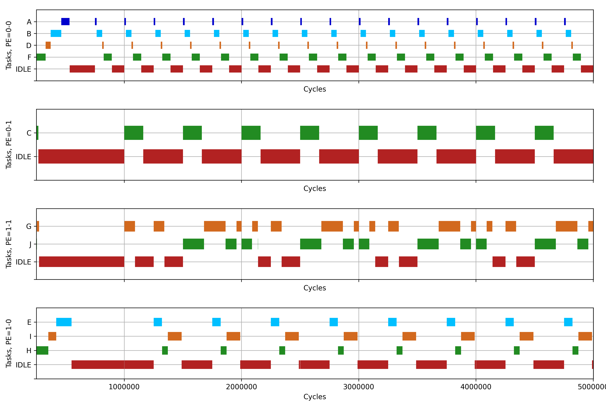

# ORCA RT-Tools

Pre-runtime analysis of computation and communication for periodic task graphs on best-effort NoC-based manycores: CPU schedule per processing element (PE), contention-free link schedule with time-triggered packet injection, and the lowest clock frequency at which both meet the deadlines. The repository holds the analysis tools, the RTL of the ORCA2 manycore, the UCX-OS kernel, and the pipelines that reproduce every number of the paper.

[](https://github.com/CCcassiusdjs/orca-rt-tools/actions/workflows/tests.yml) <!-- anon:drop-line -->
   -green)

| Document | Content |
|---|---|
| [`ARTIFACT.md`](ARTIFACT.md) | Commands that reproduce the numbers of the paper, with outputs and run times |
| [`experiments/README.md`](experiments/README.md) | Pipelines of the paper, one directory per experiment |
| This file | Overview, layout, installation, quick start, tools, tests |

## Analysis flow



| Step | Tool | Result |
|---|---|---|
| 1. Clustering | ORT/GCM (MIN-COMM, MAX-COMM, MIN-PROC, MAX-PROC) | One cluster per PE, lowest standard deviation of the cluster demands |
| 2. Mapping | Spiral Mapping, or a mapping file (`.map`) | One PE per cluster |
| 3. CPU time analysis | ORT/GCPA, ORT/BENCH (per PE) | CPU time estimate, dispatch order, start and finish of each task, $f_{\mathrm{CPU}}$ |
| 4. Flow instantiation | ORT/FNS | Packets of one hyperperiod with release and deadline |
| 5. Link schedule | ORT/FNS, AGS | Injection instant of each packet, no two packets on a shared link in the same cycle |
| 6. Frequency search | Doubling and bisection | Lowest feasible clock, $\max(f_{\mathrm{NoC}}, f_{\mathrm{CPU}})$, with its link schedule |

## Platform and phase model



The ORCA2 manycore has one RV32E core (HF-RISC), one dual-port RAM and one DDMA network interface per tile, Hermes routers with XY routing and wormhole switching, and UCX-OS on every core. The phase model releases each task at a tick and delivers its outputs in a later phase; the kernel injects each packet at its instant of the link schedule.



## Repository layout

| Path | Content |
|---|---|
| [`orca-rt-tools/rttools`](orca-rt-tools/rttools) | Analysis tools (ORT/GCM, ORT/GCPA, ORT/BENCH, ORT/FNS, AGS, frequency search, static WCET, terminal interface); `rttools/paper` holds the pipelines of the paper |
| [`orca-rt-tools/tests`](orca-rt-tools/tests) | Tests of the Python tools and of the stored runs |
| [`pkt-sim/hw`](pkt-sim/hw) | RTL: Hermes router and NoC (VHDL), RV32E core, DDMA, PE (SystemVerilog) |
| [`pkt-sim/software/ucx-os`](pkt-sim/software/ucx-os) | UCX-OS kernel, NoC driver with time-triggered injection (`lib/noc_tt.c`), release by tick (`lib/tick_release.c`), applications |
| [`apps`](apps) | Task graphs, mappings and costs (application E, CAR, CAR-V, WCET-E) |
| [`arch`](arch) | NoC platforms (2x2, 2x3, 4x4, 4x5 and 5x5 meshes) |
| [`experiments`](experiments) | One pipeline per experiment of the paper, each with its `reference*.json` |
| [`docs/img`](docs/img) | Figures of this file |

## Installation

| Use | Software |
|---|---|
| Analysis and pipelines | Python 3.10 or later, `pip install -r orca-rt-tools/requirements.txt` |
| Tests | pytest; gcc with AddressSanitizer for the UCX-OS host tests; Verilator 5 and GHDL 4 for the RTL tests |
| Zero-load latency pipeline (`experiments/zll`) | GHDL 4 |
| New RTL simulation | Questa Sim or ModelSim, riscv64-elf-gcc 12.2.0 |

## Quick start

```
pip install -r orca-rt-tools/requirements.txt
cd orca-rt-tools
python -m rttools ../apps/synthetic-app-e/synthetic-app-e.csv spiral ../arch/hermes-2x2.gml
```

The command runs steps 1 to 6 on application E and prints $f_{\mathrm{CPU}}$, $f_{\mathrm{NoC}}$, the clock frequency and the link schedule.

## Reproduce the paper

```
make -C experiments PYTHON=python3
```

Each pipeline compares its output with the stored reference and prints `match`.

| Result of the paper | Pipeline |
|---|---|
| Contraction criteria on random graphs (Section 5) | [`experiments/ch7`](experiments/ch7) |
| CPU time per PE against the estimate (RQ1) | [`experiments/cputime`](experiments/cputime) |
| Response, packets and data age in RTL simulation (RQ2) | [`experiments/exp23`](experiments/exp23), [`experiments/car-v-rtl`](experiments/car-v-rtl), [`experiments/multiapp`](experiments/multiapp), [`experiments/wcet`](experiments/wcet), [`experiments/car-full`](experiments/car-full) |
| Term that sets the clock, event-triggered baseline, skew (RQ3, Table 5) | [`experiments/ablation`](experiments/ablation), [`experiments/zll`](experiments/zll) |
| Engine-control workloads, seeds 1 to 10 (Section 7.7) | [`experiments/automotive`](experiments/automotive) (`make seeds setter`) |
| Analysis flow on every run, run times of the flow (Section 7.1) | [`experiments/tt`](experiments/tt) (`make timing`) |
| Zero-load latency of the Hermes RTL | [`experiments/zll`](experiments/zll) |

[`ARTIFACT.md`](ARTIFACT.md) lists every command with its output and run time.

## Terminal user interface

`python -m rttools.tui` (run from `orca-rt-tools/`) opens a terminal user interface with four tabs. It runs over SSH on the simulation server; with `pip install textual-dev`, `textual serve "python -m rttools.tui"` serves the same interface to a web browser.

| Tab | Content |
|---|---|
| Trace | Gantt of RTL logs (ModelSim/Questa transcript or extracted events), `rttools.bench` output, KProfiler `.sch` and CSV. Cursor and mark with the interval in raw units, cycles, ns, µs and ms; raw unit presets for the RTL (100 ps for a PE without `` `timescale ``, 1 ns); time per task and utilization per lane; bursts between passes through IDLE; latency of the packets (`->`/`<-` TAG lines); comparison of two runs with a time scale; export to SVG, PNG and CSV |
| Bench | Task set editor; ORT/BENCH simulation (RM, DM, EDF, RR) with configurable quantum; utilization, Liu-Layland, hyperbolic, response time (also with release jitter equal to the quantum) and EDF processor demand tests; observed response times |
| Network | Application, mapping and NoC (or an example of `apps/`); flows at a frequency (hops, flits, network time); frequency search in a child process with live progress and cancel; link schedule, link utilization, packets with slack, independent validation of the schedule |
| Graphs | Task graph in ORCA format: GDE metrics, GCPA cost and critical path, layers, GCM clustering (MAX_PROC with 4 clusters on `apps/sample-graph-b` gives ABDF, C, EHI and GJ) |

The Help tab (F1) lists the keys. Commands without the interface, for batch use:

| Command | Output |
|---|---|
| `python -m rttools.tui stats <trace> [--unit 100ps] [--display cycles]` | Lane metrics, bursts and packet latency as Markdown tables |
| `python -m rttools.tui export <trace> <out.svg\|out.png\|out.csv> [--display ms]` | Gantt or CSV |
| `python -m rttools.tui compare <A> <B> [--scale-b 10]` | Comparison per lane; exit code 0 when identical |

The `rttools.log2gannt` tool draws the Gantt of an RTL log:



## Tests

The repository includes tests for the Python tools, the UCX-OS NoC driver and the RTL of the DDMA, the Hermes crossbar, the TCD and the manycore PE.

| Part | Location | Tools |
|---|---|---|
| Python tools (`rttools`, bench, gff, rgg, log2gannt, appparser, TUI) | `orca-rt-tools/tests` | Python 3.10+, `orca-rt-tools/requirements.txt`, pytest |
| UCX-OS driver (`lib/noc.c`, `device/ddma.c`) on the host | `pkt-sim/software/ucx-os/tests/host` | gcc with AddressSanitizer and UBSan |
| RTL (DDMA, Hermes crossbar, TCD, manycore PE) | `pkt-sim/tests/rtl` | Verilator 5, GHDL 4 |

Run all tests:

```
pip install -r orca-rt-tools/requirements.txt pytest
cd orca-rt-tools && python -m pytest -q
```

The RTL tests skip when Verilator or GHDL is missing. `pkt-sim/software/ucx-os/tests/host/run.sh` and `pkt-sim/tests/rtl/run.sh` run the C and RTL tests without pytest.

<!-- anon:drop-begin -->
## Command-line options

| Tool | Option |
|---|---|
| `python -m rttools <app> <map> <arch> [<freq>] [<pruning factor>] [<fail threshold>] [<optimize True\|False>]` | All optional arguments work; the exit code is 1 on errors |
| `python -m rttools.bench <file> <mode> <RR\|RM\|DM\|EDF> [<horizon>]` | Scheduling policy and simulation horizon. The ORCA graph format accepts `label wcet [period [deadline]]` |
| `python -m rttools.rgg <a> <b> <c> <x> <y> <z> <ofile> [<seed>]` | Seed for reproducible graphs |
| `python -m rttools.log2gannt <log> [--map <json>] [--out <png>] [--units-per-ms <n>] [--swap-xy]` | Task map, output file, time unit, and X-Y order of the log |

## Time unit of the RTL logs

`pkt-sim/manycore_modelsim/manycore_pe.sv` declares `` `timescale 1ns/1fs ``, so the simulation logs (`scheduled`, `TAG`, `TRIGGER`) report time in ns. A PE without this directive takes the 100 ps unit of the simulator, and its logs report time in units of 100 ps (`log2gannt --units-per-ms 10000000`). `manycore_pe.sv` labels a PE as X-Y (`addr_x()` = `ADDRESS[15:8]`, `addr_y()` = `ADDRESS[7:0]`); the default map of `log2gannt` follows the Y-X order of the versioned logs `pkt-sim/schedule*.txt`, and `log2gannt --swap-xy` reads X-Y logs with it.
<!-- anon:drop-end -->

## Legacy content

<details>
<summary>MiniZinc models and the first command-line flow</summary>

Welcome to the ORCA RT-Tools repository. In this repository you will find the following assets:

- Minizinc constraint models for optimizing real-time traffic in networks-on-chip
- A single data model, used for all applications and noc architectures
- A python program suite that automates the optmization process, which we call "rt_tools"
- An RTL simulator written for the Hermes NoC

## Requirements and Installation

We've tested RT_TOOLS in CentOS 7, Ubuntu 20.4, and Debian 11 packages, although it may work out-of-the-box in most linux distributions. The following packages are required for RT_TOOLS to run in a linux environment. 

- python3 (3.8+)
- python3-devel
- graphviz
- graphviz-devel

RT_TOOLS depends on some python packages, enlisted below. 

- networkx==2.7.1
- pyparsing==2.4.7
- pygraphviz==1.9
- matplotlib==3.5.1

In addition to the aforementioned packages, you must install Minizinc, following the instruction provided in their own website. Please visit https://www.minizinc.org/ for more information.

For the RTL simulator, you must have ModelSim (or Questa) installed in your system. Please note that the simulation may work with other simulation tools with minimal effort, although we have not tested it yet. 

## How to use it 

Before using rt_tools, you must provide three models: application, architecture, and mapping. See the provided example models to learn the syntax of each model. Once you've done modeling, you can use rt_tools to generate the input model for minizinc, using the command `python3 __main__.py pkt <A> <B> <C>` replacing A, B and C by your application, architecture, and mapping model files. Be careful to provide files in the right sequence.

The output must show a couple of debugging information, followed by a section named `OCCUPANCY MATRICES (MINIZINC)`. The content of this section must be saved into a file (minizinc uses \*.dnz extension). Run minizinc passing both the \*.dnz file along with the provided \*.mnz file, and its done! You command line should look like `minizinc --solver Gecode <dnz> <mnz> > output.txt`.

## ...in a nutshell
1) `python3 rt_tools/__main__.py pkt applications/app.gml mappings/map.gml architectures/arch.gml > output.dnz`
2) `minizinc minizinc/DM/dmxxx.dmz output.dnz`

</details>

## License

GNU Affero General Public License v3.0 ([`LICENSE`](LICENSE)).
